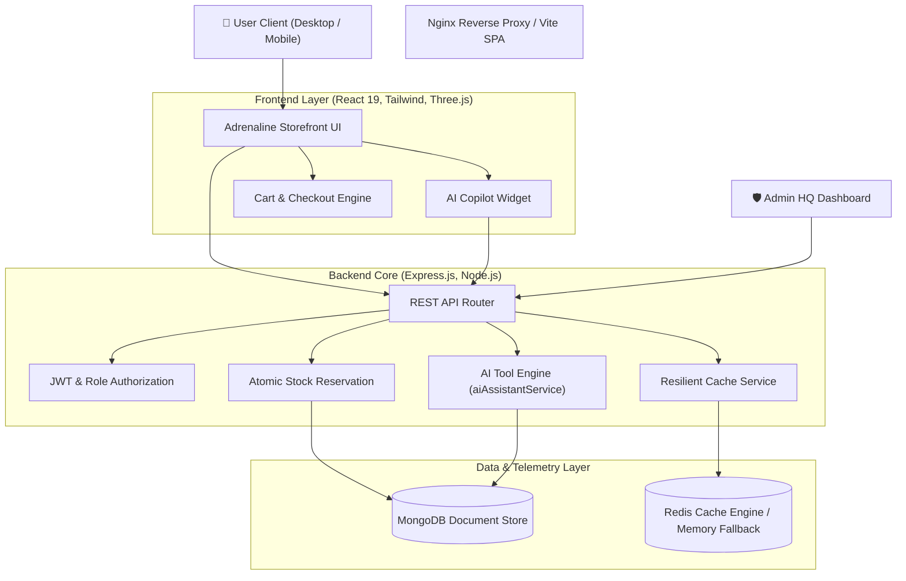

# 🏎️ ADRENALINE ENERGY STORE — Advanced MERN + AI E-Commerce Platform

An aerodynamic, high-performance energy drink e-commerce platform built with the MERN stack (MongoDB, Express, React, Node.js), powered by an **AI Shopping Copilot with real-time backend tool execution**, **atomic inventory reservation**, and **resilient Redis caching**.

---

## 🏗️ System Architecture



---

## 🚀 Key Features

### 1. Modern Aerodynamic UI & Storefront
- **Background Video & 3D Interactive Can Canvas**: Three.js Stars + React Three Fiber perspective camera (preserved background animation video).
- **Antigravity Mode**: Toggles between extreme-yield caffeinated F1 profiles and zero-caffeine hydration recovery profiles.
- **Product Discovery & Filtering**: Real-time keyword search, category pills (`HIGH_OCTANE`, `ENDURANCE`, `RECOVERY`), zero-sugar toggles, and multi-factor sorting (price, popularity, rating, caffeine).
- **Responsive Navigation**: Desktop top bar with profile dropdown, and mobile navigation drawer with active driver telemetry indicators.

### 2. AI Shopping Copilot with Backend Tools
Connected directly to backend endpoints (`POST /api/ai/chat`) with strict server-side validation:
- `searchProducts`: Natural-language search mapped to verified MongoDB queries.
- `compareProducts`: Compares price, caffeine, sugar, and stock across formulas side-by-side.
- `getRecommendations`: Recommends formulas based on caffeine threshold and category.
- `getMyOrders`: Authenticated order tracking restricted strictly to the caller's own orders.
- `searchStorePolicies`: Retrieves official shipping, refund, and Antigravity mode guidelines.

### 3. Server-Side Cart & Atomic Inventory Control
- **No Client Price Trust**: Product pricing and subtotal are calculated and verified from database records.
- **Overselling Protection**: Atomically reserves stock using `$inc: { stock: -qty }` conditioned on `stock: { $gte: qty }`.
- **Automatic Restocking**: If a customer or admin cancels or refunds an order, inventory is atomically replenished back to the database.

### 4. Resilient Redis Caching
- **Cache-Aside Architecture**: Caches `/api/products` and product details with TTL.
- **In-Memory Fallback**: If Redis is offline or not installed, the application automatically engages a built-in in-memory TTL cache without crashing or failing requests.
- **Cache Invalidation**: Automatically invalidates product caches whenever stock is modified or orders are processed.

### 5. Admin Telemetry Command Center
- Accessible via Admin Role or PIN (`2004`) at `/admin`.
- **Real-time Analytics**: Gross revenue, total orders, average order value (AOV), low-stock warnings, and cache hit rate.
- **Top Performing Formulas**: Aggregated units sold and revenue metrics.
- **Live Inventory Restock**: One-click quick restock (`+10`, `+50`) with instant database updates.
- **Customer Manifest Dispatch**: Manage order statuses from `PROCESSING` to `SHIPPED` and `DELIVERED`.

---

## 📁 Project Structure

```
├── adrenaline-app/                  # React Frontend Application
│   ├── src/
│   │   ├── components/              # AgentWidget, ScrollToTop
│   │   ├── pages/                   # HomePage, AdminPage, AuthPage, AddressPage, OrderHistoryPage...
│   │   ├── utils/                   # auth.js (token & user state management)
│   │   ├── App.jsx                  # Main router, layout & cart modal
│   │   └── main.jsx
│   ├── Dockerfile
│   └── package.json
├── backend/                         # Express.js REST API
│   ├── middleware/                  # authMiddleware, adminMiddleware
│   ├── models/                      # Product, Order, User, Address
│   ├── routes/                      # authRoutes, productRoutes, orderRoutes, addressRoutes, aiRoutes
│   ├── services/                    # aiAssistantService, cacheService
│   ├── tests/                       # api.test.js
│   ├── server.js                    # Core API Server & health endpoints
│   ├── Dockerfile
│   └── package.json
├── .github/workflows/               # GitHub Actions CI/CD Pipeline
├── docker-compose.yml               # Multi-service container orchestration
└── README.md
```

---

## 🛠️ Getting Started Locally

### Prerequisites
- Node.js (v18+)
- MongoDB (optional for basic testing; in-memory fallback included)
- Redis (optional; in-memory cache fallback included)

### 1. Installation
Clone repository and install dependencies:
```bash
npm run install:all
```

### 2. Configure Environment Variables
Copy the example environment files:
```bash
cp backend/.env.example backend/.env
cp adrenaline-app/.env.example adrenaline-app/.env
```

### 3. Run Development Servers
Start both backend API and frontend Vite dev server concurrently:
```bash
npm run dev
```
- Frontend: `http://localhost:5173`
- Backend API: `http://localhost:5000`
- Health Endpoint: `http://localhost:5000/health`
- Readiness Endpoint: `http://localhost:5000/ready`

---

## 🧪 Automated Testing

Run the backend test suite:
```bash
cd backend
npm test
```

Build the frontend bundle:
```bash
cd adrenaline-app
npm run build
```

---

## 🐳 Docker Deployment

To launch the complete infrastructure (Frontend, Backend, MongoDB, and Redis) with Docker Compose:

```bash
docker compose up --build
```
Access the application:
- Frontend: `http://localhost`
- Backend API: `http://localhost:5000`
- Redis: `localhost:6379`
- MongoDB: `localhost:27017`

---

## 🔒 Security & Authorization

1. **Password Security**: Passwords hashed using `bcryptjs` with salt rounds before storage.
2. **JWT Telemetry**: 7-day signed JWT tokens containing user ID and role.
3. **Role-Based Access Control**: Sensitive routes (`/api/orders/all`, `/api/orders/analytics`, stock management) require admin clearance or verified PIN.
4. **Rate Limiting**: AI Copilot endpoint protected by `express-rate-limit` against abuse.
5. **Scoped Isolation**: Customers can only view and update their own shipment logs.
